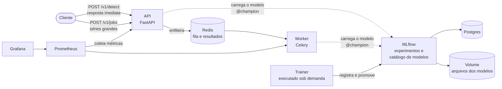

# anomaly-as-service

[](https://github.com/falconeee/anomaly-as-service/actions/workflows/ci.yml)


Serviço de detecção de anomalias em séries temporais com **explicação**. Ele recebe as medições de
um sistema (por exemplo, CPU, memória e latência de um servidor ao longo do tempo) e responde
**quando** algo saiu do normal, **quão grave** foi e **quais variáveis** causaram o problema.

O projeto cobre o ciclo completo de um modelo de machine learning em produção: treino, avaliação,
versionamento, API, processamento em fila, containers, CI/CD e monitoramento.

## Sumário

1. [O problema](#1-o-problema)
2. [A solução em resumo](#2-a-solução-em-resumo)
3. [Como funciona](#3-como-funciona)
4. [Tecnologias utilizadas](#4-tecnologias-utilizadas)
5. [Como utilizar o serviço](#5-como-utilizar-o-serviço)
6. [Como trabalhar com novos dados](#6-como-trabalhar-com-novos-dados)
7. [Resultados](#7-resultados)
8. [Desenvolvimento sem Docker](#8-desenvolvimento-sem-docker)
9. [Configuração](#9-configuração)
10. [Monitoramento](#10-monitoramento)
11. [Estrutura do repositório](#11-estrutura-do-repositório)
12. [Limitações e próximos passos](#12-limitações-e-próximos-passos)
13. [Documentação detalhada](#13-documentação-detalhada)

---

## 1. O problema

Sistemas monitorados geram várias métricas ao mesmo tempo. Essas métricas formam uma **série
temporal multivariada**: uma tabela com uma linha por instante e uma coluna por variável.

| timestamp | cpu | memória | latência_ms |
|---|---|---|---|
| 10:00 | 41 | 63 | 120 |
| 10:01 | 40 | 63 | 119 |
| 10:02 | 97 | 64 | 380 |

Detectar problemas nesses dados é difícil por dois motivos:

- **Limites fixos por variável não bastam.** Alguns problemas não aparecem em nenhuma variável
  isolada: todas ficam em faixas normais, mas deixam de se comportar como costumam *juntas*
  (por exemplo, o tráfego sobe e a CPU não acompanha).
- **Saber que algo está errado não basta.** Quem recebe o alerta precisa saber **onde olhar**:
  quais variáveis causaram a anomalia e o quanto se desviaram.

## 2. A solução em resumo

```
série temporal (JSON) ──▶ API ──▶ modelo MSCVAE ──▶ anomalias com explicação (JSON)
```

Para cada anomalia, a resposta informa:

| Campo | Exemplo |
|---|---|
| Período | de 07:14 a 07:42, pico às 07:26 |
| Severidade | `high` (score 45 vezes acima do limiar) |
| Causas | `f04`, responsável por 100% do desvio |
| Tipo de causa | `magnitude` (valor fora do comum) ou `correlation` (relação com as outras variáveis quebrou) |
| Observado × esperado | recebido 90,89; o modelo esperava 58,64 |
| Explicação em texto | "Anomalia de severidade alta entre 07:14 e 07:42 [...] Principais causas: f04 [...]" |

## 3. Como funciona

### 3.1 O modelo (MSCVAE)

1. **Fotografias das relações.** Para cada instante, o modelo pega as últimas 10, 30 e 60
   medições e calcula o quanto cada par de variáveis se move junto (matrizes de correlação em três
   escalas de tempo).
2. **Aprender o normal.** Uma rede neural (*autoencoder variacional* com camadas convolucionais e
   um *Transformer*) é treinada apenas com dados normais para comprimir e reconstruir essas
   fotografias e os valores brutos.
3. **Medir a surpresa.** Em dados novos, o **erro de reconstrução** vira o score de anomalia. O que
   a rede nunca viu, ela reconstrói mal.
4. **Definir o limiar.** O limiar é calculado com Teoria de Valores Extremos (algoritmo SPOT): a
   partir dos maiores erros observados em dados normais **não usados no treino**, escolhe-se um
   valor que dados normais só ultrapassariam com probabilidade de 1 em 10.000.
5. **Agrupar em eventos.** Instantes consecutivos acima do limiar formam um evento. A severidade
   depende de quantas vezes o score superou o limiar (`low` < 1,5×, `medium` < 3×, `high` ≥ 3×).
6. **Explicar.** O erro de cada variável é comparado com o erro típico **dela mesma**. São causas
   as variáveis que desviaram muito do próprio normal e se destacaram em relação às demais. A
   explicação em texto é montada a partir desses números, sem modelo de linguagem: a mesma entrada
   sempre gera a mesma explicação.

### 3.2 A arquitetura



| Componente | Função |
|---|---|
| API | Recebe as séries, responde na hora (séries pequenas) ou enfileira (séries grandes) |
| Worker | Processa a fila com exatamente o mesmo código da API |
| Trainer | Treina um modelo, avalia, registra no MLflow e decide se ele entra em produção |
| MLflow | Guarda o histórico de treinos e as versões dos modelos |
| Redis | Fila de trabalhos e armazenamento dos resultados |
| Prometheus + Grafana | Métricas e dashboard |

### 3.3 O ciclo de vida do modelo

```
treino ─▶ avaliação ─▶ registro no MLflow como nova versão (apelido @challenger)
                                │
                                ▼  regra de promoção: candidato × modelo atual, nos mesmos dados
           a métrica do candidato é pelo menos tão boa quanto a do atual (com tolerância)
           e o tempo de resposta está dentro do limite?
                 │ sim                               │ não
                 ▼                                   ▼
   @champion passa a apontar para a nova versão   nada muda; o motivo fica registrado
                 │
                 ▼
   API e workers trocam de modelo sozinhos, sem reiniciar
```

- `@champion` é a versão em produção; `@challenger` é a candidata mais recente.
- Voltar para uma versão anterior (rollback) é apenas mover o `@champion`.
- Cada versão guarda o commit do código, o hash dos dados, a configuração, as métricas e a decisão
  de promoção.

## 4. Tecnologias utilizadas

| Tecnologia | Uso no projeto |
|---|---|
| **Python 3.12** + **uv** | Linguagem e gerenciador de dependências, com versões travadas em `uv.lock` |
| **PyTorch** | Rede neural do modelo (GPU do Mac no desenvolvimento, CPU nos containers) |
| **pandas**, **NumPy**, **SciPy** | Manipulação dos dados e cálculo do limiar estatístico |
| **FastAPI** + **Pydantic** | API HTTP e validação das requisições |
| **Celery** + **Redis** | Fila para processamento em segundo plano |
| **MLflow** | Registro de experimentos, catálogo de versões de modelos e promoção |
| **PostgreSQL** | Banco de dados do MLflow |
| **Docker** + **Docker Compose** | Empacotamento e execução de toda a infraestrutura |
| **GitHub Actions** | Testes automáticos e publicação de imagens |
| **Prometheus** + **Grafana** | Coleta de métricas e dashboard |
| **pytest**, **ruff**, **mypy**, **pre-commit** | Testes, padrão de código e verificação de tipos |

## 5. Como utilizar o serviço

### 5.1 Pré-requisitos

- [Docker Desktop](https://www.docker.com/products/docker-desktop/) (ou Docker Engine com Compose)
- `make` (já disponível no macOS e na maioria das distribuições Linux)

No macOS, se o comando `docker` não for encontrado no terminal, adicione
`/Applications/Docker.app/Contents/Resources/bin` ao `PATH`.

### 5.2 Subir o serviço

```bash
git clone https://github.com/falconeee/anomaly-as-service.git
cd anomaly-as-service
make up             # constrói as imagens e sobe API, worker, MLflow, Postgres e Redis
make train-docker   # treina um modelo de demonstração (dados sintéticos) e o coloca em produção
make e2e            # (opcional) testa tudo de ponta a ponta; termina com "E2E OK"
```

O primeiro `make up` baixa o PyTorch e pode levar alguns minutos.

| Interface | Endereço |
|---|---|
| Documentação interativa da API | http://localhost:8000/docs |
| MLflow (treinos e versões) | http://localhost:5050 |
| Grafana (após `make monitoring`) | http://localhost:3000 |

A chave de acesso padrão da API é `change-me`. Para alterá-la, copie `.env.example` para `.env` e
edite `API_KEY`.

### 5.3 Enviar uma série para análise

O corpo da requisição tem uma lista de valores **por variável** e, opcionalmente, os timestamps:

```json
{
  "timestamps": ["2024-01-03T02:00:00", "2024-01-03T02:01:00", "..."],
  "series": {
    "f00": [61.2, 60.8, "..."],
    "f01": [33.9, 34.1, "..."]
  },
  "options": {"top_k": 3, "language": "pt"}
}
```

Exemplo com o arquivo incluído no repositório (1.500 pontos, 8 variáveis, 4 anomalias inseridas):

```bash
curl -s -X POST localhost:8000/v1/detect \
  -H 'X-API-Key: change-me' -H 'Content-Type: application/json' \
  -d @examples/request_synthetic.json
```

Regras da requisição:

- os nomes das variáveis devem ser os mesmos usados no treino (`GET /v1/models/current` lista
  quais são); a ordem não importa e variáveis extras são ignoradas;
- todas as listas devem ter o mesmo tamanho;
- valores ausentes podem ser enviados como `null`;
- os primeiros pontos (59 no modelo SMD, 19 no de demonstração: a maior janela menos 1) servem de
  histórico e não geram alertas (`warmup_points`). Envie a série com histórico suficiente antes do trecho de interesse.

### 5.4 Entender a resposta

Resposta real (resumida) para o exemplo acima:

```json
{
  "model": {"name": "mscvae-synthetic", "version": "1", "alias": "champion"},
  "threshold": 115.42,
  "n_points": 1500,
  "warmup_points": 19,
  "ignored_features": [],
  "anomalies": [
    {
      "start_index": 314, "end_index": 342, "peak_index": 326,
      "start": "2024-01-03T07:14:00", "end": "2024-01-03T07:42:00", "peak": "2024-01-03T07:26:00",
      "max_score": 5232.55,
      "threshold_ratio": 45.33,
      "severity": "high",
      "root_causes": [
        {"variable": "f04", "contribution_pct": 100.0, "peak_z": 16265.2,
         "kind": "magnitude", "observed": 90.893386, "expected": 58.63648}
      ],
      "explanation": "Anomalia de severidade alta entre 2024-01-03T07:14:00 e 2024-01-03T07:42:00 (pico em 2024-01-03T07:26:00); score 45.3× o limiar. Principais causas: f04 (100% da contribuição): valor 90.89 acima do esperado (58.64), desvio de >100σ em relação ao seu erro normal."
    }
  ]
}
```

| Campo | Significado |
|---|---|
| `model` | Modelo e versão que produziram a resposta |
| `threshold` | Limiar de score do modelo |
| `warmup_points` | Pontos iniciais usados só como histórico |
| `ignored_features` | Variáveis enviadas que o modelo não usa |
| `start_index`, `end_index`, `peak_index` | Posições (linha) de início, fim e pico da anomalia na série enviada |
| `start`, `end`, `peak` | Os mesmos instantes em data/hora (quando os timestamps são enviados) |
| `threshold_ratio` | Quantas vezes o maior score do evento superou o limiar |
| `severity` | `low` (< 1,5×), `medium` (< 3×) ou `high` (≥ 3×) |
| `root_causes[].contribution_pct` | Parcela da anomalia atribuída à variável |
| `root_causes[].peak_z` | Quantos desvios-padrão o erro da variável ficou acima do erro normal dela |
| `root_causes[].kind` | `magnitude`: o valor saiu do comum. `correlation`: a relação com as demais variáveis mudou |
| `root_causes[].observed`, `expected` | Valor recebido e valor que o modelo considera normal |
| `explanation` | Resumo em texto (português ou inglês) |

### 5.5 Opções da requisição

| Opção | Padrão | Efeito |
|---|---|---|
| `top_k` | 3 | Número máximo de causas por anomalia |
| `z_thresh` | 3.0 | Desvio mínimo para uma variável ser considerada causa |
| `max_gap` | 5 | Trechos anômalos separados por até esse número de janelas normais viram um só evento |
| `include_scores` | false | Inclui o score de cada ponto na resposta |
| `include_warmup` | false | Também procura anomalias nos pontos iniciais |
| `language` | `pt` | Idioma da explicação: `pt` ou `en` |

### 5.6 Séries grandes: processamento em fila

Acima de 20.000 pontos (`SYNC_MAX_POINTS`), `/v1/detect` responde **413** e o pedido deve ser
enviado para a fila:

```bash
# 1. Enviar (responde imediatamente com um identificador)
curl -s -X POST localhost:8000/v1/jobs -H 'X-API-Key: change-me' \
  -H 'Content-Type: application/json' -H 'Idempotency-Key: pedido-42' \
  -d @examples/request_synthetic.json
# {"job_id": "e6722f62...", "status": "queued", "status_url": "/v1/jobs/e6722f62..."}

# 2. Consultar até "succeeded"; o campo "result" tem o mesmo formato de /v1/detect
curl -s localhost:8000/v1/jobs/e6722f62... -H 'X-API-Key: change-me'
```

- `Idempotency-Key` (opcional): reenviar o mesmo pedido com a mesma chave devolve o mesmo trabalho,
  sem duplicar o processamento.
- `"callback_url": "https://..."` (opcional, no corpo): o resultado é enviado para esse endereço
  quando o trabalho termina.

### 5.7 Todos os endpoints

| Método | Rota | Função |
|---|---|---|
| POST | `/v1/detect` | Análise imediata |
| POST | `/v1/jobs` | Análise em fila (séries grandes) |
| GET | `/v1/jobs/{id}` | Situação e resultado de um trabalho |
| GET | `/v1/models/current` | Modelo em uso, limiar e variáveis esperadas |
| POST | `/admin/reload` | Recarrega o modelo imediatamente |
| GET | `/health/live`, `/health/ready` | Processo no ar / modelo carregado |
| GET | `/metrics` | Métricas no formato do Prometheus |

Respostas de erro: **401** (chave ausente ou incorreta), **413** (série grande demais para análise
imediata), **422** (requisição inválida ou variáveis faltando, listadas em `missing`), **503**
(ainda não há modelo em produção).

### 5.8 Parar o serviço

```bash
make down           # para os containers e mantém modelos e histórico
make clean-docker   # para e apaga todos os dados
```

## 6. Como trabalhar com novos dados

Cada modelo aprende o comportamento normal de **um sistema específico**, com um conjunto fixo de
variáveis. Para monitorar um sistema novo, treina-se um modelo com os dados dele.

### 6.1 Preparar o arquivo CSV

Uma linha por instante e uma coluna por variável:

```
timestamp,cpu,memoria,latencia_ms,label
2024-01-01T00:00:00,41.2,63.0,120.5,0
2024-01-01T00:01:00,40.8,63.4,118.9,0
2024-01-01T00:02:00,97.1,64.1,380.2,1
```

| Coluna | Obrigatória | Observação |
|---|---|---|
| `timestamp` | Não | Usada para ordenar as linhas e para exibir datas nas respostas |
| variáveis numéricas | Sim | Todas as colunas numéricas são usadas, salvo se `features` for definido |
| `label` | Não | `1` em anomalias conhecidas e `0` no restante; usada **apenas para medir** a qualidade do modelo |

Cuidados com os dados:

- **O início do arquivo deve ser majoritariamente normal.** As primeiras 70% das linhas treinam o
  modelo (o que for visto ali será considerado normal); as últimas 30% avaliam o modelo.
- **Intervalo regular entre medições** (por exemplo, uma linha por minuto). As janelas do modelo
  são contadas em linhas.
- **Quantidade de dados:** alguns milhares de linhas no mínimo. O SMD, por exemplo, usa cerca de
  28 mil linhas para treino.
- Variáveis que não mudam durante o treino são descartadas automaticamente.
- Sem a coluna `label`, o modelo é treinado normalmente, mas as métricas de qualidade ficam
  zeradas e a regra de promoção só verifica o tempo de resposta.

Para experimentar o processo sem ter dados próprios, há um CSV de exemplo gerado artificialmente:

```bash
make sample-csv     # cria datasets/exemplo.csv (6 sensores, 4.500 linhas, com coluna label)
```

### 6.2 Criar a configuração do treino

Copie o modelo de configuração e ajuste o caminho do arquivo e o nome do modelo:

```bash
cp configs/train_csv_example.yaml configs/meu_sistema.yaml
```

```yaml
experiment: meu-sistema
registered_model: meu-sistema        # nome usado pela API para carregar o modelo
data:
  source: csv
  path: datasets/meu_sistema.csv     # coloque o CSV na pasta datasets/
  timestamp_column: timestamp        # null se não houver
  label_column: label                # null se não houver
  test_fraction: 0.3
model:
  window_sizes: [5, 10, 20]          # tamanho das janelas, em linhas
training:
  epochs: 10
```

Ajuste de `window_sizes`: as janelas devem cobrir a duração típica dos padrões do sistema. Com uma
linha por minuto, `[10, 30, 60]` cobre de 10 minutos a 1 hora; para variações mais lentas, use
janelas maiores. Mais épocas (`epochs`) costumam melhorar o modelo à custa de mais tempo de treino.

### 6.3 Treinar, avaliar e registrar

Com Docker (a pasta `datasets/` é acessível dentro do container de treino):

```bash
make train-docker CONFIG=configs/meu_sistema.yaml
```

Sem Docker (registra no MLflow local, ver seção 8):

```bash
make train CONFIG=configs/meu_sistema.yaml
```

O comando treina o modelo, calcula as métricas, registra a nova versão no MLflow e aplica a regra
de promoção. A última linha mostra o resultado, por exemplo
`promoted=True reason=no champion yet`. As métricas, o gráfico do score e o *model card* podem
ser consultados em http://localhost:5050, no experimento `meu-sistema`.

### 6.4 Servir o novo modelo

A API serve um modelo por vez, definido pela variável `MODEL_NAME`. Para trocar:

```bash
echo "MODEL_NAME=meu-sistema" >> .env
make up             # recria API e worker com o novo modelo
```

Confirme com `GET /v1/models/current`, que deve mostrar `"name": "meu-sistema"` e a lista de
variáveis esperadas.

### 6.5 Enviar dados do novo sistema

A requisição deve conter as mesmas variáveis do CSV de treino. Para gerar uma requisição a partir
do trecho de teste do próprio CSV:

```bash
make request CONFIG=configs/meu_sistema.yaml OUT=request.json
curl -s -X POST localhost:8000/v1/detect -H 'X-API-Key: change-me' \
  -H 'Content-Type: application/json' -d @request.json
```

Em produção, o sistema monitorado envia periodicamente as medições recentes (incluindo o histórico
de aquecimento) no mesmo formato.

### 6.6 Treinar novamente

Com mais dados ou outra configuração, basta repetir o passo 6.3. A nova versão só substitui a
atual se tiver desempenho pelo menos equivalente nos dados de teste, e a API passa a usá-la
automaticamente em até 15 segundos. Para voltar a uma versão anterior:

```bash
docker compose run --rm trainer promote status --model meu-sistema
docker compose run --rm trainer promote rollback --model meu-sistema --version 1
```

## 7. Resultados

### Dados sintéticos (modelo de demonstração, ~15 s de treino em CPU)

| F1 | F1 com point-adjust | AUC-PR | Falsos alarmes | Acerto das causas (HitRate@100%) |
|---|---|---|---|---|
| 0,455 | 0,559 | 0,428 | 3,0% | 1,00 |

O modelo detecta os dois picos e o desvio gradual inseridos nos dados de exemplo, sempre apontando
a variável correta. A quebra de correlação, a anomalia mais sutil, não é detectada nesta
configuração reduzida. Calcular o limiar com dados não usados no treino reduziu os falsos alarmes
de 5,6% para 3,0%.

### SMD, `machine-1-1` (dataset público de métricas de servidores, Su et al., 2019)

| Versão | F1 | F1 com point-adjust | AUC-PR | F1 no melhor limiar | Falsos alarmes | HitRate@100% | HitRate@150% | Promoção |
|---|---|---|---|---|---|---|---|---|
| v1 | 0,382 | 0,408 | 0,623 | 0,615 | 30,3% | 0,511 | 0,688 | aprovada |
| v2 | 0,369 | 0,377 | 0,635 | 0,617 | 34,5% | 0,605 | 0,784 | **reprovada** |

Leitura dos resultados:

- O score distingue bem as anomalias (AUC-PR de 0,63; com o melhor limiar possível, o F1 chegaria
  a 0,62), e a análise de causa identifica de 60% a 78% das variáveis responsáveis.
- O limiar fixo gera muitos falsos alarmes porque o período de teste do SMD tem comportamento
  diferente do período de treino. Ajustar o limiar continuamente é o próximo passo natural.
- A v2 melhorou a identificação das causas, mas piorou o F1, e por isso foi reprovada pela regra
  de promoção: a v1 continuou em produção.

Glossário das métricas: F1 equilibra alarmes corretos e anomalias encontradas; *point-adjust*
conta um trecho anômalo inteiro como encontrado se qualquer ponto dele for detectado (prática comum
em artigos, mas que infla os números); AUC-PR mede a qualidade do score independentemente do
limiar; HitRate mede a fração das variáveis causadoras reais entre as primeiras apontadas pelo
modelo. Mais detalhes em [`docs/fase-2-treino-mlflow.md`](docs/fase-2-treino-mlflow.md).

## 8. Desenvolvimento sem Docker

Requisito: [uv](https://docs.astral.sh/uv/) (no macOS: `brew install uv`).

```bash
make setup     # cria o ambiente Python e instala as dependências exatas do uv.lock
make check     # padrão de código, tipos e testes automatizados
make train     # treina o modelo de demonstração; MLflow local em mlflow.db
make mlflow    # interface do MLflow em http://localhost:5050
make serve     # API em http://localhost:8000 (PORT=8001 se a stack Docker estiver no ar)
make help      # lista todos os comandos
```

Neste modo, `/v1/detect` funciona normalmente; `/v1/jobs` precisa do Redis e do worker da stack
Docker. No Mac, o treino usa a GPU (MPS) automaticamente.

## 9. Configuração

Variáveis de ambiente, definidas em `.env` (ver [`.env.example`](.env.example)):

| Variável | Padrão | Descrição |
|---|---|---|
| `API_KEY` | `change-me` no Docker; vazia fora dele | Chave exigida no cabeçalho `X-API-Key` (vazia = sem autenticação, só para desenvolvimento) |
| `MODEL_NAME` | `mscvae-synthetic` | Nome do modelo servido (o `registered_model` da configuração de treino) |
| `MODEL_ALIAS` | `champion` | Versão servida |
| `MODEL_REFRESH_INTERVAL_S` | 15 no Docker; 60 fora dele | Intervalo, em segundos, para verificar se há nova versão em produção |
| `SYNC_MAX_POINTS` | 20000 | Máximo de pontos em `/v1/detect` |
| `ASYNC_MAX_POINTS` | 500000 | Máximo de pontos em `/v1/jobs` |
| `LOG_LEVEL` | `INFO` | Nível de detalhe dos logs |
| `MLFLOW_PORT` | 5050 | Porta do MLflow no computador (a 5000 é usada pelo AirPlay no macOS) |

## 10. Monitoramento

```bash
make monitoring     # Prometheus em http://localhost:9090 e Grafana em http://localhost:3000
```

O dashboard do Grafana mostra:

- **saúde do serviço:** requisições por segundo, tempo de resposta, taxa de erros, trabalhos na
  fila;
- **comportamento do modelo:** versão em uso, anomalias por minuto, evolução dos scores e mudança
  nos dados recebidos em relação aos dados de treino.

As métricas do modelo existem porque um serviço pode estar rápido e sem erros e ainda assim errar:
se os dados mudam, o modelo deixa de representar o sistema. Detalhes em
[`docs/fase-8-observabilidade.md`](docs/fase-8-observabilidade.md).

## 11. Estrutura do repositório

```
src/anomaly_service/
├── model/            modelo MSCVAE, salvamento seguro, adaptador para o MLflow
├── data/             dados sintéticos, leitura do SMD e de CSV, geração de requisições de exemplo
├── training/         configuração, métricas, pipeline de treino, promoção e rollback
├── inference/        detecção, agrupamento em eventos, explicações, troca automática de modelo
├── api/              aplicação FastAPI e endpoints
├── worker/           Celery: tarefas de detecção e webhook
├── schemas.py        formato das requisições e respostas
├── jobs.py           registro dos trabalhos em fila
├── observability.py  métricas
└── config.py         variáveis de ambiente
configs/              configurações de treino (sintético, SMD, modelo para CSV)
docker/               Dockerfiles e script de inicialização dos containers
monitoring/           Prometheus e Grafana
scripts/e2e.sh        teste de ponta a ponta
tests/                testes unitários, de integração e da API
docs/                 documentação detalhada por etapa
```

## 12. Limitações e próximos passos

- **Limiar fixo:** não acompanha mudanças graduais no comportamento do sistema. Um limiar
  ajustado continuamente exigiria guardar estado entre requisições.
- **Um modelo por vez na API:** servir vários sistemas exigiria escolher o modelo pela rota
  (por exemplo, `/v1/models/{nome}/detect`).
- **Promoção sem tráfego real:** um próximo passo seria testar o candidato com parte do tráfego
  antes de promovê-lo.
- **Séries muito grandes na fila:** poderiam ser armazenadas em um serviço de arquivos, enviando
  à fila apenas a referência.
- **Análise de mudança nos dados por requisição:** relatórios agregados por período dariam uma
  visão mais estável.

## 13. Documentação detalhada

Cada etapa do projeto tem um guia com explicações e um passo a passo para reproduzir:

| Etapa | Guia |
|---|---|
| Visão geral e glossário | [docs/00-visao-geral.md](docs/00-visao-geral.md) |
| 0. Ambiente e ferramentas | [docs/fase-0-fundacao.md](docs/fase-0-fundacao.md) |
| 1. Modelo pronto para produção | [docs/fase-1-modelo.md](docs/fase-1-modelo.md) |
| 2. Treino, avaliação e dados próprios | [docs/fase-2-treino-mlflow.md](docs/fase-2-treino-mlflow.md) |
| 3. Versionamento e promoção | [docs/fase-3-registry.md](docs/fase-3-registry.md) |
| 4. API | [docs/fase-4-api.md](docs/fase-4-api.md) |
| 5. Processamento em fila | [docs/fase-5-filas.md](docs/fase-5-filas.md) |
| 6. Containers | [docs/fase-6-containers.md](docs/fase-6-containers.md) |
| 7. CI/CD | [docs/fase-7-cicd.md](docs/fase-7-cicd.md) |
| 8. Monitoramento | [docs/fase-8-observabilidade.md](docs/fase-8-observabilidade.md) |
