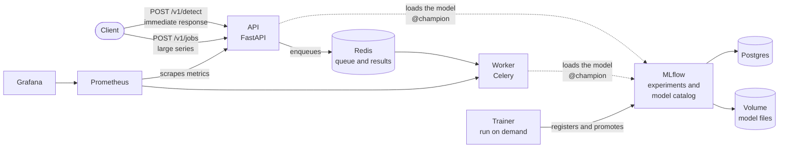

# anomaly-as-service

[](https://github.com/falconeee/anomaly-as-service/actions/workflows/ci.yml)


Time series anomaly detection service with **explanations**. It receives a system's
measurements (for example, a server's CPU, memory and latency over time) and answers
**when** something went out of normal, **how severe** it was and **which variables** caused the problem.

The project covers the full lifecycle of a machine learning model in production: training, evaluation,
versioning, API, queue processing, containers, CI/CD and monitoring.

## Contents

1. [The problem](#1-the-problem)
2. [The solution in short](#2-the-solution-in-short)
3. [How it works](#3-how-it-works)
4. [Technologies used](#4-technologies-used)
5. [How to use the service](#5-how-to-use-the-service)
6. [How to work with new data](#6-how-to-work-with-new-data)
7. [Results](#7-results)
8. [Development without Docker](#8-development-without-docker)
9. [Configuration](#9-configuration)
10. [Monitoring](#10-monitoring)
11. [Repository structure](#11-repository-structure)
12. [Limitations and next steps](#12-limitations-and-next-steps)
13. [Detailed documentation](#13-detailed-documentation)

---

## 1. The problem

Monitored systems produce many metrics at the same time. Those metrics form a **multivariate
time series**: a table with one row per instant and one column per variable.

| timestamp | cpu | memory | latency_ms |
|---|---|---|---|
| 10:00 | 41 | 63 | 120 |
| 10:01 | 40 | 63 | 119 |
| 10:02 | 97 | 64 | 380 |

Detecting problems in this data is hard for two reasons:

- **Fixed per-variable limits are not enough.** Some problems do not show up in any single
  variable: all of them stay within normal ranges, but they stop behaving as they usually do *together*
  (for example, traffic goes up and CPU does not follow).
- **Knowing that something is wrong is not enough.** Whoever receives the alert needs to know **where to look**:
  which variables caused the anomaly and by how much they deviated.

## 2. The solution in short

```
time series (JSON) ──▶ API ──▶ MSCVAE model ──▶ anomalies with explanations (JSON)
```

For each anomaly, the response reports:

| Field | Example |
|---|---|
| Period | from 07:14 to 07:42, peak at 07:26 |
| Severity | `high` (score 45 times above the threshold) |
| Causes | `f04`, responsible for 100% of the deviation |
| Cause type | `magnitude` (unusual value) or `correlation` (the relationship with the other variables broke) |
| Observed × expected | received 90.89; the model expected 58.64 |
| Text explanation | "Anomalia de severidade alta entre 07:14 e 07:42 [...] Principais causas: f04 [...]" (Portuguese by default; English with `language: en`) |

## 3. How it works

### 3.1 The model (MSCVAE)

1. **Snapshots of the relationships.** For each instant, the model takes the last 10, 30 and 60
   measurements and computes how much each pair of variables moves together (correlation matrices at three
   time scales).
2. **Learning normal.** A neural network (a *variational autoencoder* with convolutional layers and
   a *Transformer*) is trained on normal data only to compress and reconstruct those
   snapshots and the raw values.
3. **Measuring surprise.** On new data, the **reconstruction error** becomes the anomaly score. What
   the network has never seen, it reconstructs poorly.
4. **Setting the threshold.** The threshold is computed with Extreme Value Theory (the SPOT algorithm): from
   the largest errors observed on normal data **not used in training**, it picks a
   value that normal data would only exceed with a probability of 1 in 10,000.
5. **Grouping into events.** Consecutive instants above the threshold form an event. The severity
   depends on how many times the score exceeded the threshold (`low` < 1.5×, `medium` < 3×, `high` ≥ 3×).
6. **Explaining.** Each variable's error is compared with **its own** typical error. The causes are
   the variables that deviated a lot from their own normal and stood out relative to the others. The
   text explanation is built from those numbers, without a language model: the same input
   always produces the same explanation.

### 3.2 The architecture



| Component | Role |
|---|---|
| API | Receives the series, answers right away (small series) or enqueues them (large series) |
| Worker | Processes the queue with exactly the same code as the API |
| Trainer | Trains a model, evaluates it, registers it in MLflow and decides whether it goes into production |
| MLflow | Keeps the training history and the model versions |
| Redis | Job queue and result storage |
| Prometheus + Grafana | Metrics and dashboard |

### 3.3 The model lifecycle

```
training ─▶ evaluation ─▶ registered in MLflow as a new version (alias @challenger)
                                │
                                ▼  promotion rule: candidate × current model, on the same data
           is the candidate's metric at least as good as the current one's (with tolerance)
           and is the response time within the limit?
                 │ yes                               │ no
                 ▼                                   ▼
   @champion now points to the new version       nothing changes; the reason is recorded
                 │
                 ▼
   API and workers switch models by themselves, without restarting
```

- `@champion` is the version in production; `@challenger` is the most recent candidate.
- Going back to a previous version (rollback) just means moving `@champion`.
- Each version stores the code commit, the data hash, the configuration, the metrics and the promotion
  decision.

## 4. Technologies used

| Technology | Use in the project |
|---|---|
| **Python 3.12** + **uv** | Language and dependency manager, with versions locked in `uv.lock` |
| **PyTorch** | The model's neural network (Mac GPU in development, CPU in the containers) |
| **pandas**, **NumPy**, **SciPy** | Data handling and computing the statistical threshold |
| **FastAPI** + **Pydantic** | HTTP API and request validation |
| **Celery** + **Redis** | Queue for background processing |
| **MLflow** | Experiment tracking, model version catalog and promotion |
| **PostgreSQL** | MLflow's database |
| **Docker** + **Docker Compose** | Packaging and running the whole infrastructure |
| **GitHub Actions** | Automated tests and image publishing |
| **Prometheus** + **Grafana** | Metric collection and dashboard |
| **pytest**, **ruff**, **mypy**, **pre-commit** | Tests, code style and type checking |

## 5. How to use the service

### 5.1 Prerequisites

- [Docker Desktop](https://www.docker.com/products/docker-desktop/) (or Docker Engine with Compose)
- `make` (already available on macOS and most Linux distributions)

On macOS, if the `docker` command is not found in the terminal, add
`/Applications/Docker.app/Contents/Resources/bin` to `PATH`.

### 5.2 Start the service

```bash
git clone https://github.com/falconeee/anomaly-as-service.git
cd anomaly-as-service
make up             # builds the images and starts API, worker, MLflow, Postgres and Redis
make train-docker   # trains a demo model (synthetic data) and puts it into production
make e2e            # (optional) tests everything end to end; ends with "E2E OK"
```

The first `make up` downloads PyTorch and may take a few minutes.

| Interface | Address |
|---|---|
| Interactive API documentation | http://localhost:8000/docs |
| MLflow (training runs and versions) | http://localhost:5050 |
| Grafana (after `make monitoring`) | http://localhost:3000 |

The API's default access key is `change-me`. To change it, copy `.env.example` to `.env` and
edit `API_KEY`.

### 5.3 Send a series for analysis

The request body has a list of values **per variable** and, optionally, the timestamps:

```json
{
  "timestamps": ["2024-01-03T02:00:00", "2024-01-03T02:01:00", "..."],
  "series": {
    "f00": [61.2, 60.8, "..."],
    "f01": [33.9, 34.1, "..."]
  },
  "options": {"top_k": 3, "language": "pt"}
}
```

Example with the file included in the repository (1,500 points, 8 variables, 4 injected anomalies):

```bash
curl -s -X POST localhost:8000/v1/detect \
  -H 'X-API-Key: change-me' -H 'Content-Type: application/json' \
  -d @examples/request_synthetic.json
```

Request rules:

- the variable names must be the same ones used in training (`GET /v1/models/current` lists
  them); the order does not matter and extra variables are ignored;
- all lists must have the same length;
- missing values can be sent as `null`;
- the first points (59 for the SMD model, 19 for the demo one: the largest window minus 1) serve as
  history and do not raise alerts (`warmup_points`). Send the series with enough history before the stretch of interest.

### 5.4 Understand the response

Real (abridged) response for the example above:

```json
{
  "model": {"name": "mscvae-synthetic", "version": "1", "alias": "champion"},
  "threshold": 115.42,
  "n_points": 1500,
  "warmup_points": 19,
  "ignored_features": [],
  "anomalies": [
    {
      "start_index": 314, "end_index": 342, "peak_index": 326,
      "start": "2024-01-03T07:14:00", "end": "2024-01-03T07:42:00", "peak": "2024-01-03T07:26:00",
      "max_score": 5232.55,
      "threshold_ratio": 45.33,
      "severity": "high",
      "root_causes": [
        {"variable": "f04", "contribution_pct": 100.0, "peak_z": 16265.2,
         "kind": "magnitude", "observed": 90.893386, "expected": 58.63648}
      ],
      "explanation": "Anomalia de severidade alta entre 2024-01-03T07:14:00 e 2024-01-03T07:42:00 (pico em 2024-01-03T07:26:00); score 45.3× o limiar. Principais causas: f04 (100% da contribuição): valor 90.89 acima do esperado (58.64), desvio de >100σ em relação ao seu erro normal."
    }
  ]
}
```

| Field | Meaning |
|---|---|
| `model` | Model and version that produced the response |
| `threshold` | The model's score threshold |
| `warmup_points` | Initial points used only as history |
| `ignored_features` | Variables sent that the model does not use |
| `start_index`, `end_index`, `peak_index` | Positions (row) of the anomaly's start, end and peak in the series sent |
| `start`, `end`, `peak` | The same instants as date/time (when timestamps are sent) |
| `threshold_ratio` | How many times the event's highest score exceeded the threshold |
| `severity` | `low` (< 1.5×), `medium` (< 3×) or `high` (≥ 3×) |
| `root_causes[].contribution_pct` | Share of the anomaly attributed to the variable |
| `root_causes[].peak_z` | How many standard deviations the variable's error was above its normal error |
| `root_causes[].kind` | `magnitude`: the value was unusual. `correlation`: the relationship with the other variables changed |
| `root_causes[].observed`, `expected` | Value received and value the model considers normal |
| `explanation` | Text summary (Portuguese or English) |

### 5.5 Request options

| Option | Default | Effect |
|---|---|---|
| `top_k` | 3 | Maximum number of causes per anomaly |
| `z_thresh` | 3.0 | Minimum deviation for a variable to be considered a cause |
| `max_gap` | 5 | Anomalous stretches separated by up to this many normal windows become a single event |
| `include_scores` | false | Includes each point's score in the response |
| `include_warmup` | false | Also looks for anomalies in the initial points |
| `language` | `pt` | Language of the explanation: `pt` or `en` |

### 5.6 Large series: queue processing

Above 20,000 points (`SYNC_MAX_POINTS`), `/v1/detect` responds **413** and the request must be
sent to the queue:

```bash
# 1. Submit (responds immediately with an identifier)
curl -s -X POST localhost:8000/v1/jobs -H 'X-API-Key: change-me' \
  -H 'Content-Type: application/json' -H 'Idempotency-Key: request-42' \
  -d @examples/request_synthetic.json
# {"job_id": "e6722f62...", "status": "queued", "status_url": "/v1/jobs/e6722f62..."}

# 2. Poll until "succeeded"; the "result" field has the same format as /v1/detect
curl -s localhost:8000/v1/jobs/e6722f62... -H 'X-API-Key: change-me'
```

- `Idempotency-Key` (optional): resending the same request with the same key returns the same job,
  without duplicating the processing.
- `"callback_url": "https://..."` (optional, in the body): the result is sent to that address
  when the job finishes.

### 5.7 All endpoints

| Method | Route | Purpose |
|---|---|---|
| POST | `/v1/detect` | Immediate analysis |
| POST | `/v1/jobs` | Queued analysis (large series) |
| GET | `/v1/jobs/{id}` | Status and result of a job |
| GET | `/v1/models/current` | Model in use, threshold and expected variables |
| POST | `/admin/reload` | Reloads the model immediately |
| GET | `/health/live`, `/health/ready` | Process up / model loaded |
| GET | `/metrics` | Metrics in Prometheus format |

Error responses: **401** (missing or wrong key), **413** (series too large for immediate
analysis), **422** (invalid request or missing variables, listed in `missing`), **503**
(there is no model in production yet).

### 5.8 Stop the service

```bash
make down           # stops the containers and keeps models and history
make clean-docker   # stops and deletes all data
```

## 6. How to work with new data

Each model learns the normal behavior of **one specific system**, with a fixed set of
variables. To monitor a new system, you train a model on its data.

### 6.1 Prepare the CSV file

One row per instant and one column per variable:

```
timestamp,cpu,memoria,latencia_ms,label
2024-01-01T00:00:00,41.2,63.0,120.5,0
2024-01-01T00:01:00,40.8,63.4,118.9,0
2024-01-01T00:02:00,97.1,64.1,380.2,1
```

| Column | Required | Note |
|---|---|---|
| `timestamp` | No | Used to sort the rows and to show dates in the responses |
| numeric variables | Yes | Every numeric column is used, unless `features` is set |
| `label` | No | `1` on known anomalies and `0` elsewhere; used **only to measure** the model's quality |

Data caveats:

- **The beginning of the file must be mostly normal.** The first 70% of the rows train the
  model (whatever is seen there will be considered normal); the last 30% evaluate it.
- **Regular interval between measurements** (for example, one row per minute). The model's windows
  are counted in rows.
- **Amount of data:** a few thousand rows at least. SMD, for example, uses about
  28 thousand rows for training.
- Variables that do not change during training are discarded automatically.
- Without the `label` column, the model trains normally, but the quality metrics are
  zero and the promotion rule only checks the response time.

To try the process without your own data, there is an artificially generated sample CSV:

```bash
make sample-csv     # creates datasets/exemplo.csv (6 sensors, 4,500 rows, with a label column)
```

### 6.2 Create the training configuration

Copy the configuration template and adjust the file path and the model name:

```bash
cp configs/train_csv_example.yaml configs/my_system.yaml
```

```yaml
experiment: my-system
registered_model: my-system          # name the API uses to load the model
data:
  source: csv
  path: datasets/my_system.csv       # put the CSV in the datasets/ folder
  timestamp_column: timestamp        # null if there is none
  label_column: label                # null if there is none
  test_fraction: 0.3
model:
  window_sizes: [5, 10, 20]          # window sizes, in rows
training:
  epochs: 10
```

Tuning `window_sizes`: the windows should cover the typical duration of the system's patterns. With one
row per minute, `[10, 30, 60]` covers 10 minutes to 1 hour; for slower variations, use
larger windows. More epochs (`epochs`) usually improve the model at the cost of more training time.

### 6.3 Train, evaluate and register

With Docker (the `datasets/` folder is accessible inside the training container):

```bash
make train-docker CONFIG=configs/my_system.yaml
```

Without Docker (registers in the local MLflow, see section 8):

```bash
make train CONFIG=configs/my_system.yaml
```

The command trains the model, computes the metrics, registers the new version in MLflow and applies the promotion
rule. The last line shows the result, for example
`promoted=True reason=no champion yet`. The metrics, the score plot and the *model card* can
be viewed at http://localhost:5050, in the `my-system` experiment.

### 6.4 Serve the new model

The API serves one model at a time, set by the `MODEL_NAME` variable. To switch:

```bash
echo "MODEL_NAME=my-system" >> .env
make up             # recreates API and worker with the new model
```

Confirm with `GET /v1/models/current`, which should show `"name": "my-system"` and the list of
expected variables.

### 6.5 Send data from the new system

The request must contain the same variables as the training CSV. To generate a request from
the test portion of the CSV itself:

```bash
make request CONFIG=configs/my_system.yaml OUT=request.json
curl -s -X POST localhost:8000/v1/detect -H 'X-API-Key: change-me' \
  -H 'Content-Type: application/json' -d @request.json
```

In production, the monitored system periodically sends its recent measurements (including the warm-up
history) in the same format.

### 6.6 Retrain

With more data or another configuration, just repeat step 6.3. The new version only replaces the
current one if it performs at least as well on the test data, and the API starts using it
automatically within 15 seconds. To go back to a previous version:

```bash
docker compose run --rm trainer promote status --model my-system
docker compose run --rm trainer promote rollback --model my-system --version 1
```

## 7. Results

### Synthetic data (demo model, ~15 s of CPU training)

| F1 | F1 with point-adjust | AUC-PR | False alarms | Cause accuracy (HitRate@100%) |
|---|---|---|---|---|
| 0.455 | 0.559 | 0.428 | 3.0% | 1.00 |

The model detects the two spikes and the gradual drift injected into the sample data, always pointing to
the right variable. The correlation break, the subtlest anomaly, is not detected in this
reduced configuration. Computing the threshold on data not used in training cut false alarms
from 5.6% to 3.0%.

### SMD, `machine-1-1` (public server-metrics dataset, Su et al., 2019)

| Version | F1 | F1 with point-adjust | AUC-PR | F1 at best threshold | False alarms | HitRate@100% | HitRate@150% | Promotion |
|---|---|---|---|---|---|---|---|---|
| v1 | 0.382 | 0.408 | 0.623 | 0.615 | 30.3% | 0.511 | 0.688 | approved |
| v2 | 0.369 | 0.377 | 0.635 | 0.617 | 34.5% | 0.605 | 0.784 | **rejected** |

Reading the results:

- The score separates the anomalies well (AUC-PR of 0.63; with the best possible threshold, F1 would reach
  0.62), and the cause analysis identifies 60% to 78% of the responsible variables.
- The fixed threshold produces many false alarms because SMD's test period behaves
  differently from its training period. Adjusting the threshold continuously is the natural next step.
- v2 improved cause identification but worsened F1, so it was rejected by the promotion
  rule: v1 stayed in production.

Metric glossary: F1 balances correct alarms and anomalies found; *point-adjust*
counts a whole anomalous stretch as found if any of its points is detected (common practice
in papers, but it inflates the numbers); AUC-PR measures the score's quality regardless of the
threshold; HitRate measures the fraction of the real causal variables among the first ones the
model points to. More details in [`docs/phase-2-training-mlflow.md`](docs/phase-2-training-mlflow.md).

## 8. Development without Docker

Requirement: [uv](https://docs.astral.sh/uv/) (on macOS: `brew install uv`).

```bash
make setup     # creates the Python environment and installs the exact dependencies from uv.lock
make check     # code style, types and automated tests
make train     # trains the demo model; local MLflow in mlflow.db
make mlflow    # MLflow UI at http://localhost:5050
make serve     # API at http://localhost:8000 (PORT=8001 if the Docker stack is up)
make help      # lists every command
```

In this mode, `/v1/detect` works normally; `/v1/jobs` needs Redis and the worker from the Docker
stack. On a Mac, training uses the GPU (MPS) automatically.

## 9. Configuration

Environment variables, set in `.env` (see [`.env.example`](.env.example)):

| Variable | Default | Description |
|---|---|---|
| `API_KEY` | `change-me` in Docker; empty outside it | Key required in the `X-API-Key` header (empty = no authentication, for development only) |
| `MODEL_NAME` | `mscvae-synthetic` | Name of the served model (the `registered_model` from the training configuration) |
| `MODEL_ALIAS` | `champion` | Served version |
| `MODEL_REFRESH_INTERVAL_S` | 15 in Docker; 60 outside it | Interval, in seconds, to check for a new version in production |
| `SYNC_MAX_POINTS` | 20000 | Maximum points in `/v1/detect` |
| `ASYNC_MAX_POINTS` | 500000 | Maximum points in `/v1/jobs` |
| `LOG_LEVEL` | `INFO` | Log detail level |
| `MLFLOW_PORT` | 5050 | MLflow port on the host (5000 is used by AirPlay on macOS) |

## 10. Monitoring

```bash
make monitoring     # Prometheus at http://localhost:9090 and Grafana at http://localhost:3000
```

The Grafana dashboard shows:

- **service health:** requests per second, response time, error rate, jobs in the
  queue;
- **model behavior:** version in use, anomalies per minute, score trends and drift
  in the incoming data relative to the training data.

The model metrics exist because a service can be fast and error-free and still be wrong:
if the data changes, the model no longer represents the system. Details in
[`docs/phase-8-observability.md`](docs/phase-8-observability.md).

## 11. Repository structure

```
src/anomaly_service/
├── model/            MSCVAE model, safe serialization, MLflow adapter
├── data/             synthetic data, SMD and CSV loading, sample request generation
├── training/         configuration, metrics, training pipeline, promotion and rollback
├── inference/        detection, event grouping, explanations, automatic model switching
├── api/              FastAPI application and endpoints
├── worker/           Celery: detection and webhook tasks
├── schemas.py        request and response formats
├── jobs.py           queued job registry
├── observability.py  metrics
└── config.py         environment variables
configs/              training configurations (synthetic, SMD, CSV template)
docker/               Dockerfiles and container entrypoint script
monitoring/           Prometheus and Grafana
scripts/e2e.sh        end-to-end test
tests/                unit, integration and API tests
docs/                 detailed documentation per phase
```

## 12. Limitations and next steps

- **Fixed threshold:** it does not follow gradual changes in the system's behavior. A continuously
  adjusted threshold would require keeping state between requests.
- **One model at a time in the API:** serving several systems would require choosing the model by route
  (for example, `/v1/models/{name}/detect`).
- **Promotion without real traffic:** a next step would be to test the candidate with part of the traffic
  before promoting it.
- **Very large series in the queue:** they could be stored in a file service, sending
  only the reference to the queue.
- **Per-request data drift analysis:** reports aggregated by period would give a
  more stable view.

## 13. Detailed documentation

Each phase of the project has a guide with explanations and a step-by-step walkthrough to reproduce it:

| Phase | Guide |
|---|---|
| Overview and glossary | [docs/00-overview.md](docs/00-overview.md) |
| 0. Environment and tools | [docs/phase-0-foundation.md](docs/phase-0-foundation.md) |
| 1. Production-ready model | [docs/phase-1-model.md](docs/phase-1-model.md) |
| 2. Training, evaluation and your own data | [docs/phase-2-training-mlflow.md](docs/phase-2-training-mlflow.md) |
| 3. Versioning and promotion | [docs/phase-3-registry.md](docs/phase-3-registry.md) |
| 4. API | [docs/phase-4-api.md](docs/phase-4-api.md) |
| 5. Queue processing | [docs/phase-5-queues.md](docs/phase-5-queues.md) |
| 6. Containers | [docs/phase-6-containers.md](docs/phase-6-containers.md) |
| 7. CI/CD | [docs/phase-7-cicd.md](docs/phase-7-cicd.md) |
| 8. Monitoring | [docs/phase-8-observability.md](docs/phase-8-observability.md) |
